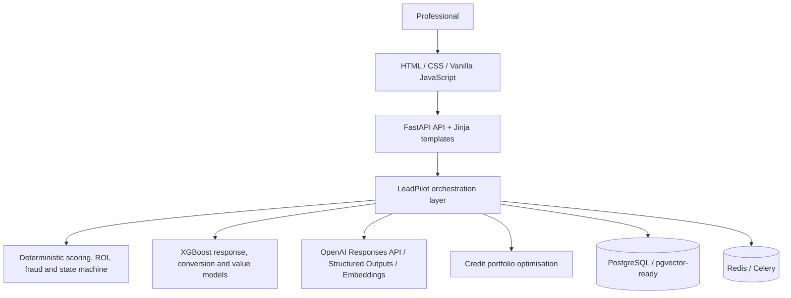

# LeadPilot AI

### Agentic AI + ML Lead Intelligence Platform for Service Marketplaces

     

LeadPilot AI is an AI engineering portfolio project that demonstrates how service professionals can make better, evidence-led choices before spending marketplace credits on customer leads.

> **Synthetic-data notice:** every lead, customer identity, contact identifier, conversation, historical interaction, budget, and outcome in this repository is fictional and synthetically generated for example and demonstration purposes. No real customer, professional, or marketplace data is used.

## The problem

In a service marketplace, a customer posts a request for work and a professional pays credits to unlock it. Photographers, plumbers, developers, designers, trainers, and tutors can lose money when a lead is low quality, a poor fit, heavily contested, fraudulent, out of budget, or unlikely to reply.

LeadPilot AI turns that uncertain choice into an explainable **BUY**, **REVIEW**, or **SKIP** decision.

## Product capabilities

- Generate exactly 15 safe synthetic leads using `@example.test` emails and non-dialable identifiers.
- Score quality, fit, intent, fraud risk, response and conversion probability, job value, expected revenue, and ROI.
- Optimize a finite credit budget with a 0/1 knapsack portfolio optimiser.
- Qualify purchased synthetic customers in a conversation workspace and persist revealed requirements.
- Produce a human handoff, quote draft, explicit approval gate, and simulated outcome.
- Track pipeline economics, explainability, and model metrics.

```text
Generate leads → Analyze → Optimize credits → Purchase → Qualify
→ Human handoff → Draft quote → Human approval → Simulate outcome → Analytics
```

The demo begins with **Nova Creative Studio**, a Leeds-based visual-content studio, and **100 fictional credits**.

## Architecture



## AI and ML design

> **ML predicts. LLM understands. Tools execute. Humans approve.**

### What ML does

| Model | Prediction | Main signals |
| --- | --- | --- |
| Response classifier | Will the customer respond? | completeness, verification, competition, intent, fit, response time |
| Conversion classifier | Will the customer hire? | predicted response, fit, budget compatibility, competition, intent |
| Job-value regressor | What is the expected job value? | budget, category, scope proxy, urgency, fit |

`scripts/generate_history.py` creates 20,000 correlated historical synthetic interactions. Outcomes are not assigned completely at random: strong fit, complete requests, verified contacts, high intent, low competition, and faster professional responses improve the simulated outcome probability.

`scripts/train_models.py` trains two `XGBClassifier` models and one `XGBRegressor`. It uses a reproducible 80/20 holdout split, persists versioned `joblib` artifacts, and reports ROC-AUC, precision, recall, F1, MAE, and RMSE.

```bash
python -m pip install -r backend/requirements.txt
python scripts/generate_history.py
python scripts/train_models.py
docker compose restart api
```

### What OpenAI does

OpenAI is reserved for qualitative understanding, never for invented probability, price, or ROI figures:

- richer fictional lead wording;
- intent classification and explanations;
- structured requirement and objection extraction;
- customer conversation summaries and suggested openings;
- quote drafting and embedding-based service matching.

The key remains backend-side. Copy `.env.example` to a local `.env` file and add the key there. `.env` files are explicitly ignored by Git.

```env
OPENAI_API_KEY=replace_with_your_key
OPENAI_TEXT_MODEL=gpt-4.1-mini
OPENAI_SMALL_MODEL=gpt-4.1-mini
OPENAI_EMBEDDING_MODEL=text-embedding-3-small
```

The complete demo works without an API key through deterministic local fallbacks.

## Technology stack

| Area | Tools | Purpose |
| --- | --- | --- |
| Backend | FastAPI, Pydantic v2, SQLAlchemy 2 | Typed API, validation, maintainable services |
| Data | PostgreSQL, pgvector-ready image | Relational workflow state and vector-search foundation |
| AI | OpenAI SDK, Responses API, Structured Outputs | Schema-constrained language understanding |
| ML | XGBoost, scikit-learn, joblib | Tabular prediction, evaluation, versioned artefacts |
| Optimisation | 0/1 knapsack formulation | Best expected value within a credit constraint |
| Infrastructure | Redis, Celery, Docker Compose | Caching, background-job foundation, repeatable setup |
| Frontend | Jinja2, HTML5, CSS3, ES6, Chart.js | Premium SaaS interface without a frontend framework |
| Quality | Pytest, Ruff, GitHub Actions | Regression tests, linting, CI |

## Run locally

```bash
docker compose up --build
```

Open:

- App: `http://localhost:8000`
- API documentation: `http://localhost:8000/docs`
- Health check: `http://localhost:8000/health`

Docker Compose starts FastAPI, PostgreSQL, Redis, and a Celery worker. No `.env` file is required for offline demo mode.

## API workflow

```text
POST /api/leads/generate
POST /api/leads/analyze-all
POST /api/leads/optimize
POST /api/leads/{id}/purchase
POST /api/leads/{id}/qualification/start
POST /api/leads/{id}/qualification/message
POST /api/leads/{id}/quote/generate
POST /api/quotes/{id}/approve
POST /api/leads/{id}/outcome/simulate
GET  /api/analytics
```

## Tests and quality checks

```bash
pytest backend/tests
ruff check backend/app backend/tests
```

Tests cover safe lead generation, score ranges, credit limits, purchase deduction, hidden-profile isolation, state transitions, human quote approval, simulated outcomes, and dashboard rendering. GitHub Actions runs linting, tests, and a Docker image build for every push and pull request.

## Responsible AI

- All data is synthetic and exists only for demonstration and portfolio purposes.
- Predictions are estimates, not automatic commercial decisions.
- Hidden customer-simulation data is isolated from lead scoring and ML prediction.
- Quotes require explicit professional approval before an outcome can be simulated.
- API keys stay server-side and are excluded from version control.

## Future improvements

- Probability calibration and model-drift monitoring
- pgvector duplicate detection and semantic similarity search
- Contextual bandits for personalised credit allocation
- Per-professional and per-category model calibration
- Follow-up timing optimisation and quote-message A/B tests
- Behavioural, anomaly, and graph-based fraud detection
- Human-feedback loops, fairness checks, and model governance dashboards

---

Built as an AI engineering portfolio project combining agentic workflows, generative AI, machine learning, optimisation, backend systems, and human-in-the-loop product design.
